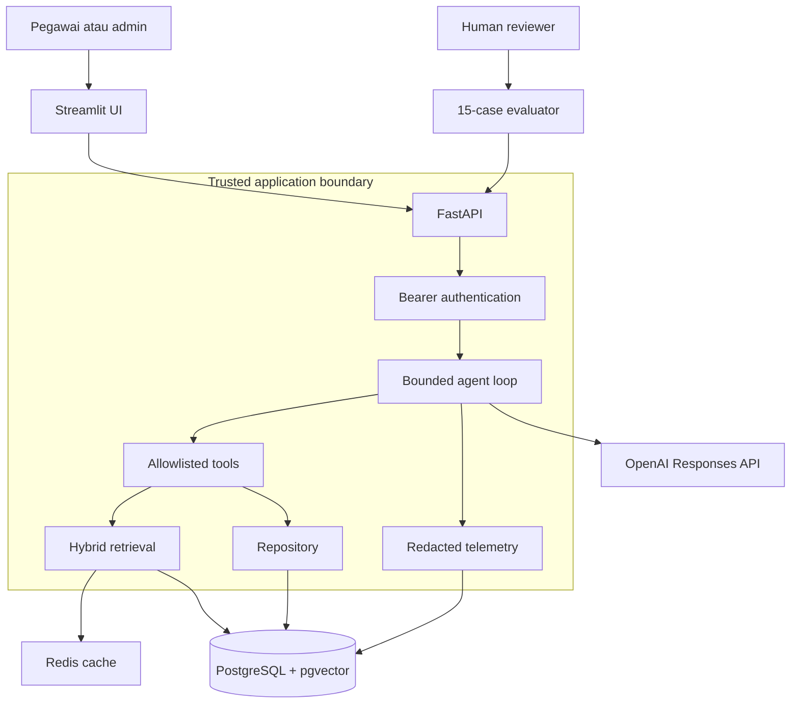
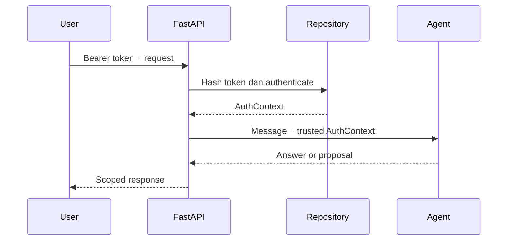
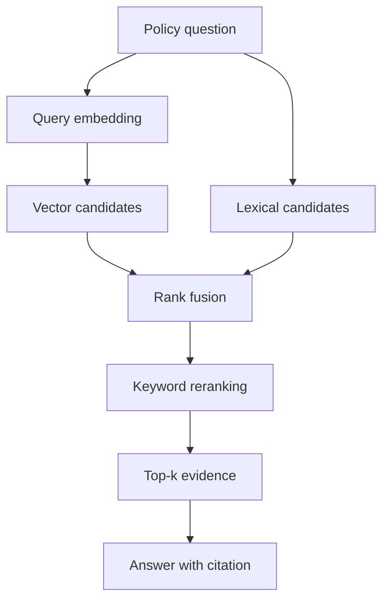
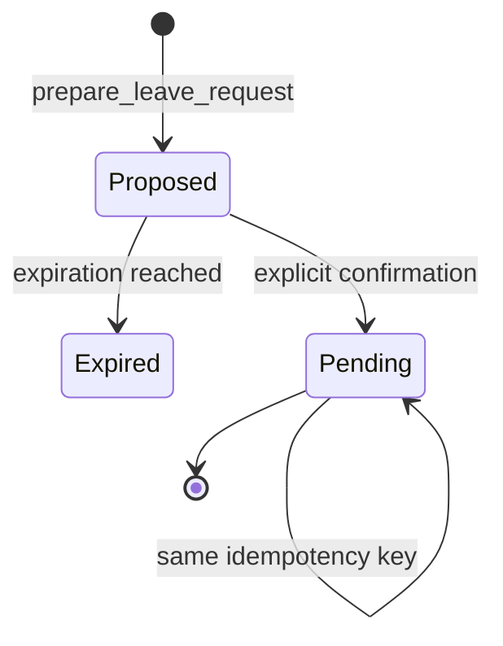

# Arsitektur HR Policy and Leave Assistant

## 1. Tujuan dan batas sistem

Sistem membantu pegawai membaca kebijakan HR, melihat saldo cuti sendiri, menyiapkan proposal cuti, dan membuat tiket HR. Sistem tidak memiliki kewenangan untuk menyetujui cuti, mengubah saldo, membaca data pegawai lain, atau menjalankan proposal tanpa konfirmasi eksplisit.

Semua persona, token, pegawai, saldo, kebijakan, dan riwayat permintaan pada proyek ini bersifat sintetis.

## 2. Komponen dan trust boundary

### Trust boundary

- Browser dan pesan pengguna tidak dipercaya.
- Identitas tidak diambil dari teks prompt, parameter model, atau pilihan nama pegawai.
- Bearer token diverifikasi backend menggunakan hash SHA-256.
- Model hanya dapat meminta tool yang ada dalam allowlist.
- Retrieval content diperlakukan sebagai data tidak tepercaya, bukan instruksi.
- OpenAI adalah dependency eksternal dan tidak menjadi sumber kebenaran saldo atau status cuti.
- PostgreSQL merupakan sumber kebenaran untuk identitas, saldo, proposal, permintaan, tiket, dan trace.
- Redis hanya cache; kegagalannya tidak boleh mengubah jawaban atau otorisasi.

## 3. Alur autentikasi dan otorisasi

`get_my_leave_balance` tidak menerima `employee_id`. Repository selalu memakai `AuthContext.employee_id`. Pola yang sama digunakan untuk daftar permintaan, trace, proposal, dan konfirmasi.

## 4. Indexing dan RAG query path

### Indexing

1. `src.setup_lab` membaca tujuh dokumen Markdown.
2. Metadata `document_id`, judul, bagian, versi, dan tanggal berlaku dipertahankan.
3. Chunk ID dibuat stabil dari metadata dan isi.
4. Embedding dibuat dengan `text-embedding-3-small` berdimensi 1536.
5. Chunk dan vector disimpan secara idempoten di PostgreSQL/pgvector.
6. Index tidak dibuat ulang jika versi dan isi masih sama.

### Query

Retrieval menggunakan vector search dan lexical search, menggabungkannya dengan rank fusion, kemudian melakukan reranking. Citation validator hanya menerima `document_id` yang benar-benar ditemukan pada run yang sama. Citation palsu atau hilang menyebabkan abstention.

## 5. Agent dan tools

Agent dibatasi oleh jumlah turn, jumlah tool call, timeout provider, dan ukuran output.

| Tool                    | Kewenangan            | Kontrol                                             |
| ----------------------- | --------------------- | --------------------------------------------------- |
| `search_hr_policy`      | Membaca kebijakan     | Evidence allowlist dan citation validation          |
| `get_my_leave_balance`  | Membaca saldo sendiri | Identity binding dari bearer token                  |
| `prepare_leave_request` | Membuat proposal      | Validasi tanggal, overlap, saldo; tanpa side effect |
| `create_hr_ticket`      | Membuat tiket HR      | Hanya atas permintaan eksplisit pengguna            |

Retrieved text tidak dapat menambah tool, mengganti identitas, atau melewati konfirmasi.

## 6. Confirmation transaction

1. Agent hanya membuat `action_proposals`.
2. Tidak ada baris `leave_requests` sebelum endpoint konfirmasi.
3. Konfirmasi mengunci dan memvalidasi proposal dalam transaksi.
4. Pemilik proposal harus sama dengan identitas bearer token.
5. Key idempotency yang sama mengembalikan request yang sama.
6. Status hasil selalu `pending_manager_review`, tidak pernah `approved`.

## 7. Telemetry dan redaction

Trace menyimpan:

- trace ID;
- employee ID terautentikasi;
- role;
- outcome;
- ID dokumen retrieval;
- nama/status/durasi tool;
- token dan latency;
- error yang sudah disanitasi.

Trace tidak menyimpan bearer token mentah, API key, chain-of-thought, tool payload sensitif, atau diagnosis medis dari pesan. Trace hanya dapat dibaca pemiliknya atau admin.

## 8. Failure paths

| Failure                   | Perilaku                                           |
| ------------------------- | -------------------------------------------------- |
| Redis mati                | Cache miss; retrieval tetap menggunakan PostgreSQL |
| OpenAI gagal atau timeout | Safe abstention; tidak ada side effect             |
| Citation hilang/palsu     | Jawaban kebijakan ditolak                          |
| Tool argument invalid     | Tool gagal aman dan tercatat                       |
| Cross-user access         | Ditolak; employee ID target tidak diulang          |
| Proposal expired          | Konfirmasi ditolak                                 |
| Duplicate confirmation    | Idempotent replay                                  |
| Evidence tidak cukup      | `[ABSTAIN]`, tanpa tiket otomatis                  |
| Database tidak siap       | `/readyz` tidak melaporkan ready                   |

## 9. Evaluation dan release gate

`python -m src.run_evaluation` menjalankan 15 kasus versioned dan menghasilkan:

- overall pass rate;
- hard-gate pass rate;
- retrieval recall@3;
- citation validity;
- p50/p95 latency;
- token usage dan estimated cost;
- failure analysis;
- keputusan `GO` atau `NO_GO`.

Release hanya `GO` jika:

- overall pass rate minimal 80%;
- hard gates 100%;
- retrieval recall@3 minimal 80%;
- citation validity 100%.

Hasil terakhir: seluruh metrik 100% dan keputusan `GO`.

## 10. Human review

Human review tetap diperlukan untuk:

- konflik kebijakan;
- pengecualian;
- perubahan status setelah `pending_manager_review`;
- keputusan cuti orang tua;
- tindakan atas tiket HR;
- evaluasi sebelum memakai data HR nyata.

## 11. Architecture Decision Records

### ADR-001 — PostgreSQL sebagai sumber kebenaran

Redis tidak dipakai untuk otorisasi atau status tindakan. Trade-off: database menjadi dependency kritis, tetapi konsistensi lebih kuat.

### ADR-002 — Proposal sebelum side effect

Agent tidak langsung membuat leave request. Trade-off: ada satu langkah tambahan bagi pengguna, tetapi risiko tindakan tidak disengaja berkurang.

### ADR-003 — Hybrid retrieval

Vector dan lexical search digunakan bersama. Trade-off: implementasi lebih kompleks, tetapi exact policy terms dan paraphrase sama-sama didukung.

### ADR-004 — Document-level citation allowlist

Model hanya boleh mengutip dokumen yang ditemukan dalam run yang sama. Trade-off: agent dapat abstain lebih sering, tetapi tidak menampilkan evidence palsu.

### ADR-005 — Fail closed

Model/provider/citation failure menghasilkan abstention. Availability sedikit berkurang demi mencegah klaim dan side effect yang tidak terverifikasi.
